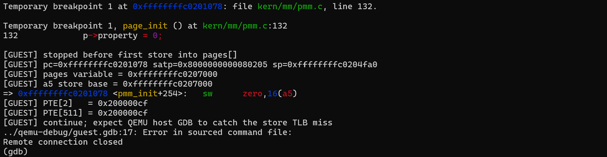
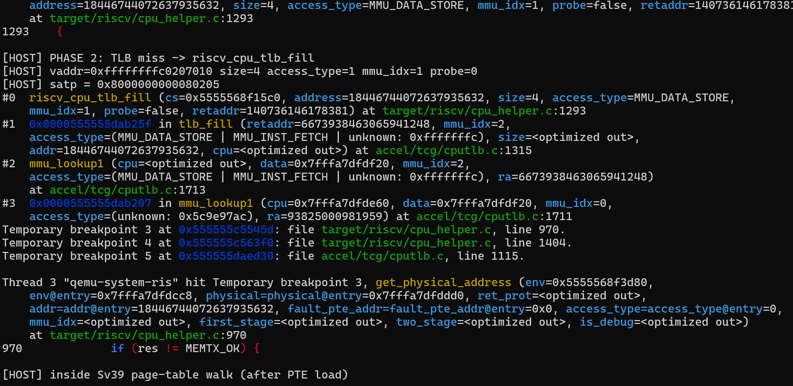
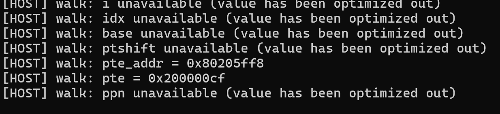
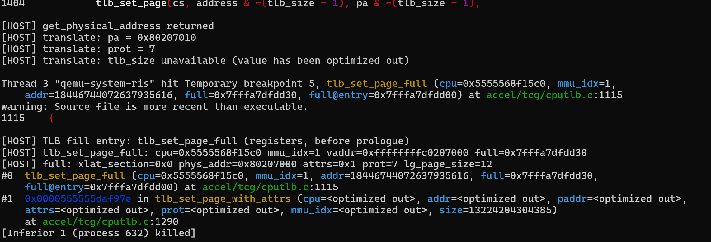
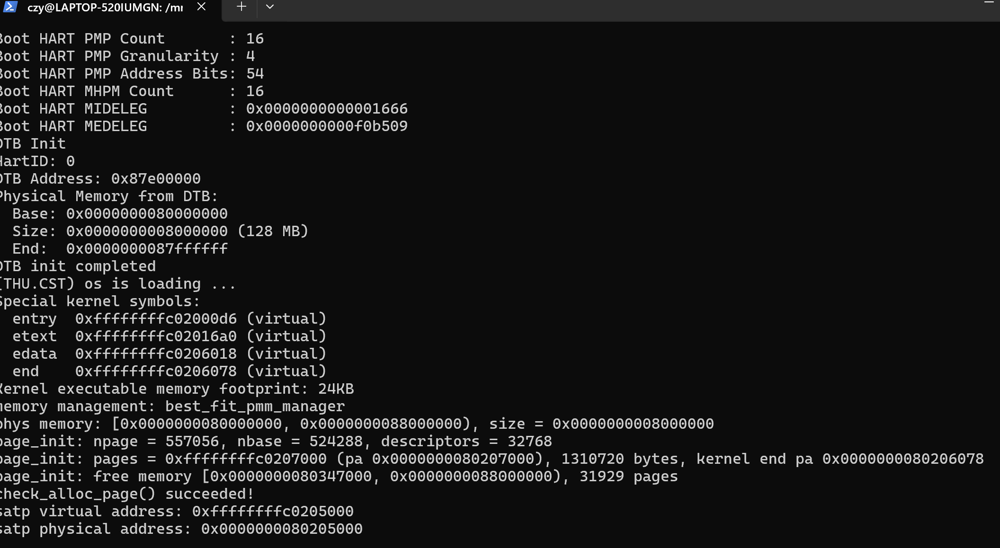
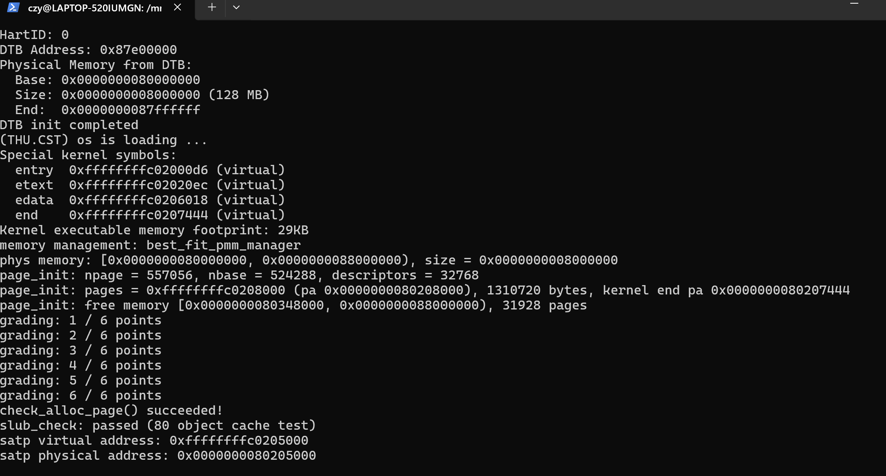
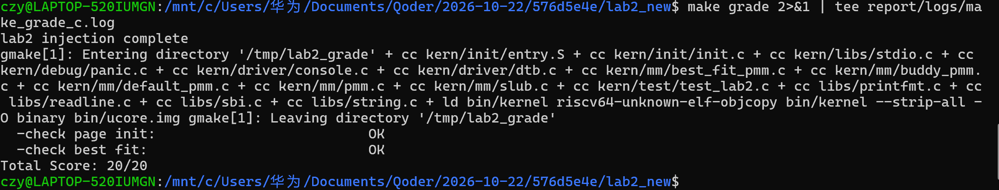

# 操作系统实验报告

## 实验基本信息

| 项目 | 内容 |
|------|------|
| **实验名称** | Lab2：物理内存管理（含 QEMU MMU 调试分支任务） |
| **小组成员** | 2411559-章伟健、2413219-黄林林、2413635-曹紫煜 |
| **完成日期** | 2026-10-23 |

### 小组分工

| 成员 | 负责的练习/模块 |
|------|----------------|
| 2411559-章伟健（A） | `page_init()`、Buddy System、启动页表与 QEMU 加载兼容、Challenge、`report/partA.md` |
| 2413219-黄林林（B） | Best-Fit 物理页管理器、SLUB 对象分配器、`report/partB.md` |
| 2413635-曹紫煜（C） | A+B 基线复验、QEMU 双重 GDB 分支任务、`report/partC.md`、三份报告合并与最终判分 |

实验报告分工：A/B/C 各自撰写本棒的报告章节；C 负责按模板合并、统一术语、
补充最终测试结果和 QEMU 调试章节。交接过程记录在 `HANDOVER.md`，按“追加式”
维护，后一棒不删改前一棒内容。

---

## 一、实验目的

本实验的主要目的是：

1. 理解操作系统启动时如何从固件/设备树获取可用物理内存范围，并建立
   `struct Page` 描述符数组。
2. 掌握连续物理页分配器的设计：First-Fit、Best-Fit、Buddy System 的差异、
   空闲链表维护、拆分与合并。
3. 理解页级分配器之上的对象级分配器：用 SLUB 把整页切成固定大小对象，
   实现 `kmem_cache` 与 `kmalloc/kfree`。
4. 通过 QEMU + 双重 GDB 观察一次真实访存的 **TLB miss → Sv39 页表遍历 →
   TLB 回填 → VA 转 PA**，理解模拟器 TLB 与真实 CPU TLB 的差异。
5. 练习用 AI 辅助完成环境修复、代码实现、测试定位和调试脚本迭代。

---

## 二、实验环境

### 2.1 软件与工具链

| 组件 | 实际版本 / 说明 |
|---|---|
| WSL | Ubuntu 24.04.1 LTS，内核 6.6.114.1-microsoft-standard-WSL2 |
| 交叉编译器 | `riscv64-unknown-elf-gcc` 13.2.0 |
| QEMU | `qemu-system-riscv64` 8.2.2（Ubuntu `1:8.2.2+ds-0ubuntu1.18`） |
| guest GDB | `gdb-multiarch` 15.1 |
| host GDB | GNU gdb 15.1（调试 QEMU 的 x86-64 进程） |
| 构建/判分 | `make`、`python3`、项目自带 `tools/grade.sh` |
| QEMU 调试符号 | Ubuntu ddebs `qemu-system-misc-dbgsym_8.2.2+ds-0ubuntu1.18_amd64.ddeb` |

> QEMU 8.2.2 的 OpenSBI 是 `fw_dynamic`。项目已把 `tools/qemu-compat.sh`
> 的自动判定改为 QEMU >= 8 使用 `-kernel`（会正确填写 `next_addr`），
> QEMU < 8 才用旧的 `-device loader`。因此直接 `make test` / `make grade`
> 即可，无需手动 export；只有需要强制旧方式时才设置
> `QEMU_LOADER_MODE=loader`。这是环境适配，不是实验逻辑的一部分。

### 2.2 AI 编程工具

| 成员 | AI 编程工具 | 底层模型 | 备注 |
|------|------------|---------|------|
| 2411559-章伟健 | DeepSeek Harness | DeepSeek-V4.1-Flash | |
| 2413219-黄林林 | Codex | DeepSeek-V4.1-Flash | 用于封装链分析、GDB 命令设计与调试排错 |
| 2413635-曹紫煜 | Qoder 桌面 Agent | DeepSeek-V4.1-Flash | 用于命令生成、QEMU 源码定位、GDB 脚本改写与报告整理 |

---

## 三、实验整体逻辑分析

### 3.1 本章节的逻辑主线

本章围绕一个问题展开：**内核启动后，如何知道“哪些物理页可以用”，并把它们
安全、可回收地分配给后续的页级和对象级需求？**

一条完整的链路是：

```text
OpenSBI 跳转内核，a0=hartid，a1=DTB 物理地址
  → entry.S 保存 hartid/DTB，建立启动页表，打开 Sv39
  → dtb_init() 从 DTB 的 /memory 节点取出 RAM 的 base/size
  → pmm_init() 选择 pmm_manager
  → page_init() 建立覆盖全部物理页的 struct Page 数组
  → 先把所有页标为 reserved，再把内核/OpenSBI/描述符数组之外的页交给分配器
  → Best-Fit（或 Buddy/First-Fit）维护空闲链表，提供 alloc_pages/free_pages
  → SLUB 在 alloc_pages(1) 之上切分固定大小对象，提供 kmalloc/kfree
  → make test / make grade 验证
```

这条链路的每一层都依赖上一层的正确性：启动页表错了，内核根本进不到 C 代码；
DTB 解析错了，`page_init` 会把设备内存当 RAM；`page_init` 的保留区算错了，
分配器会把内核自己分出去；页分配器错了，SLUB 的自检和官方判分都会失败。

### 3.2 功能的逐步实现

1. **先修启动链路**：补 `entry.S` 的恒等映射，适配 QEMU 的 `-kernel` 加载
   方式。原因：没有这一步，内核在 `csrw satp` 之后取指就缺页，后面的内存
   管理代码一行都跑不到。
2. **再实现 `page_init()`**：从 DTB 拿物理内存范围，建立 Page 描述符数组，
   划出保留区和可分配区。原因：它是所有分配器的输入；没有正确的初始空闲
   池，Best-Fit/Buddy 的算法再对也没有意义。
3. **接着实现 Best-Fit**：在 First-Fit 参考实现的基础上，选择“足够小的最小
   空闲块”，并维护按地址排序的空闲链表。原因：官方 Test 2 要求 Best-Fit，
   同时它是后续 SLUB 的底层页来源。
4. **实现 Buddy 作为对照**：按 2 的幂分裂/合并，验证另一种页级策略；但不
   接线到默认管理器，避免改变官方判分基线。
5. **最后实现 SLUB**：把 Best-Fit 分配到的整页切成 16–4096 字节的对象，
   提供 `kmem_cache_create/alloc/free` 与 `kmalloc/kfree`。原因：页级分配
   解决“连续页”，对象级分配解决“小对象不浪费整页”，两层合起来才是完整的
   内核内存分配器雏形。
6. **C 棒做双重 GDB 调试**：在真实访存上观察 TLB miss、Sv39 翻译和 TLB
   回填，把“页表在内存里、MMU 怎么用它”从概念变成可验证的调用链。

---

## 四、实验内容与实现

### 4.1 启动链路与环境修复

**负责人：** 2411559-章伟健（A）

**修改位置：**

- `kern/init/entry.S`：启动页表新增 `PTE[2]` 恒等映射
- `tools/qemu-compat.sh`（新增）、`Makefile`、`tools/grade.sh`：QEMU 加载方式兼容

**环境说明：**

成员 C 的机器为 Ubuntu 24.04 + QEMU 8.2.2（见 2.1）；成员 A 的本机为
**Ubuntu 26.04 + QEMU 10.2.1（自带 OpenSBI v1.8）**。两台机器的症状与修复方式
完全一致——都是 OpenSBI 从 `fw_jump` 换成 `fw_dynamic` 之后，`-device loader`
不再能决定跳转地址。下面按 A 本机的排查过程记录。

**功能说明：**

`entry.S` 在 `csrw satp` 之前，PC 仍指向物理地址 `0x80200xxx`；打开 Sv39 后，
如果页表没有把 `0x80000000` 这 1 GiB 恒等映射，紧接着的取指就会缺页。因此
启动页表同时保留：

| 页表项 | 映射 | 用途 |
|---|---|---|
| `PTE[2]` | `0x80000000` → `0x80000000`（1 GiB 恒等） | `satp` 打开后、`jr` 到高地址前的取指 |
| `PTE[511]` | `0xFFFFFFFFC0000000` → `0x80000000`（1 GiB） | 跳到 `KERNBASE` 后的内核高地址映射 |

完整的因果链：

```text
csrw satp  →  分页立即生效
          →  但 PC 仍停在物理地址 0x802000xx，其 VPN2 = 0
          →  原页表只填了 PTE[511]（VPN2 = 511），PTE[2] 为 0
          →  取下一条指令即刻页错误
          →  stvec = 0x80200000，异常处理跳回 entry.S 开头
          →  重新执行 csrw satp，再次页错误 → 静默死循环
```

GDB 单步抓到的现场：

```text
pc=0x80200034   csrw satp,t0
→ Cannot access memory at address 0x80200038
```

**第二处：新版 QEMU 的 OpenSBI 不认 `-device loader`**

老版 OpenSBI 是 `fw_jump`，跳转地址在编译期写死为 `0x80200000`；新版换成
`fw_dynamic`，跳转地址来自 `a1` 指向的 `fw_dynamic_info`，而 **QEMU 只在使用
`-kernel` 时才填这个结构体**。
**这个漏洞在lab1中就被发现了**

**最终提示词（环境修复）：**

> 在 QEMU 8.2.2（OpenSBI fw_dynamic）上，内核只在 `entry.S` 打开 satp 后
> 立刻跳到 0x0，OpenSBI 打印 `Domain0 Next Address : 0x0`，`-d int` 全是
> `fault_fetch at epc=0`。请检查启动页表和 QEMU 加载方式，给出最小修复：
> 保留物理 PC 取指所需的恒等映射，并让 QEMU 通过 `-kernel` 把镜像交给
> OpenSBI，而不是只用 `-device loader`。

**实现迭代：**

- 第一次迭代：只补 `PTE[511]` 高地址映射，`csrw satp` 之后的物理 PC 取指
  仍然缺页；随后补 `PTE[2]` 的 1 GiB 恒等映射，启动通过。
- **排查方法（值得记录）**：两处不兼容的**症状完全相同**——都是"只有 OpenSBI
  横幅、内核零输出"，所以必须先分离、再分别修复。
  - 第一步用**启动日志**分离：对比 `Domain0 Next Address` 是 `0x0` 还是
    `0x80200000`，判断内核到底有没有被执行；
  - 第二步用 **GDB** 分离：在 `-kernel` 下断在 `0x80200000` 确认 entry.S 在跑，
    再单步到 `csrw satp`，看到 `Cannot access memory at address 0x80200038`，
    说明问题出在"开分页之后"；
  - 第三步分别验证修复：用 `objdump -s -j .data` 核对页表字节（项 2 与项 511
    均为 `0x200000cf`、其余为 0、表长精确 4KB），用 `make print-QEMU_LOADER`
    核对加载参数。
- 第二次迭代：QEMU 10 用 `-kernel` 正常；本机 QEMU 8.2.2 最初因
  `qemu-compat.sh` 对 8.x 仍选 `-device loader`，OpenSBI 的 `next_addr`
  为 0。把自动判定的阈值改为 `>= 8` 后，`-kernel` 自动生效，无需手动 export。
- 最终结果：`make qemu` 能打印到 `satp physical address: ...`，
  `make grade` 可正常判分。

---

### 4.2 功能模块：`page_init()` 物理内存初始化

**负责人：** 2411559-章伟健（A）

**涉及的主要函数：**

```c
static void page_init(void);
static void init_memmap(struct Page *base, size_t n);
void pmm_init(void);
struct Page *alloc_pages(size_t n);
void free_pages(struct Page *base, size_t n);
size_t nr_free_pages(void);
```

**功能说明：**

`page_init()` 负责把“DTB 报告的物理内存范围”变成“内核可管理的 Page 描述符
数组 + 初始空闲页链表”。四个容易混淆的地址概念必须分开：

| 概念 | 本实验的表示 | 例子 |
|---|---|---|
| 虚拟地址（VA） | C 指针的值，≥ `KERNBASE` | `pages = 0xffffffffc0208000` |
| 物理地址（PA） | `VA - va_pa_offset` | `0x80208000` |
| 页号（PPN） | `PA >> PGSHIFT` | `0x80208` |
| Page 描述符下标 | `PPN(pa) - nbase` | `pages[PPN - nbase]` |

实现完成后的物理内存布局：

```text
0x80000000 ┬ OpenSBI（2 MB）                            ← 永久 reserved
0x80200000 ┼ 内核镜像，end 的物理地址 = 0x80206078        ← 永久 reserved
           ├ 页对齐空隙（落在内核最后一页内部，不额外占页）
0x80207000 ┼ Page 描述符数组，32768 × 40 B = 0x140000    ← 永久 reserved
0x80347000 ┼ ★ 可分配空闲区，31929 页
0x88000000 ┴ 内存末端
```

关键数值（来自 A 本机的最终构建；地址与页数会随代码大小略有变化）：

| 量 | 值 | 依据 |
|---|---|---|
| `nbase` | `0x80000` | `PPN(DRAM_BASE)` = `0x80000000 >> 12` |
| `npage` | `0x88000` | `PPN(0x88000000)`，内存末端的页号 |
| 描述符个数 | 32768 | `npage - nbase` = 128 MB / 4 KB |
| `sizeof(struct Page)` | 40 B | `int(4)+pad(4)+u64(8)+uint(4)+pad(4)+2 个指针(16)` |
| 描述符数组大小 | `0x140000` | 32768 × 40 = 1,310,720 B |
| `pages` 起点 | `0xffffffffc0207000` | `ROUNDUP(end, PGSIZE)` |
| 空闲区 | `[0x80347000, 0x88000000)`，31929 页 | 数组末尾向上对齐 → 末端向下对齐 |

**账目核对**（验证保留区没有多算或漏算）：

```text
总物理页        32768
- OpenSBI         512（2 MB）
- 内核镜像          7（24 KB，跨页 0x80200~0x80206）
- 描述符数组      320（1.25 MB）
= 保留            839 页 = 0x80347000 - 0x80000000，与运行输出一致
```

**最终提示词：**

> 实现 `kern/mm/pmm.c` 的 `page_init()`：用 `dtb_init()` 保存的
> `memory_base/memory_size` 得到物理内存区间；设置 `va_pa_offset`；
> `npage = PPN(mem_end)`，Page 数组从内核 `end` 之后按页对齐开始，覆盖
> `[nbase, npage)`；先把所有描述符置为 `PG_reserved`，再把描述符数组之后
> 到内存末端的完整页交给 `init_memmap()`。必须通过 `tools/test_lab2.c` 的
> 8 条 page init 检查，并保证 `page2pa(pa2page(x))` 往返一致。

**实现要点：**

1. **先设 `va_pa_offset`**：`PADDR()`、`page2pa()`、`pa2page()` 都依赖它；
   在任何地址转换之前赋值。
2. **`npage = PPN(mem_end)`**：`npage` 是“内存末端之后的页号”，描述符数组
   覆盖 `[nbase, npage)`，共 `npage - nbase` 个。
3. **防下溢**：若 `npage <= nbase`，`npage - nbase` 会在 `size_t` 上下溢成
   天文数字，描述符循环会写出数组；因此先 `panic`。
4. **先全部 reserved**：OpenSBI、内核镜像、描述符数组自身都留在 reserved；
   `init_memmap()` 只“认领”它真正得到的页。
5. **可分配区边界**：从 `ROUNDUP(描述符数组物理末端, PGSIZE)` 到
   `ROUNDDOWN(mem_end, PGSIZE)`，两端都是物理地址。
6. **`init_memmap(pa2page(free_start_pa), n)`**：`pa2page()` 用
   `PPN(pa) - nbase` 找到第一个空闲页的描述符，长度按页数计。

**实现迭代：**

- 第一版按“整段 RAM 都可用”写，随后发现内核镜像和描述符数组会被分配出去；
  改为“先全部 reserved，再只把描述符数组之后的页交给 init_memmap”。
- 第二版检查了 `npage <= nbase` 的下溢边界，并把 `pages`（VA）与
  `pages_pa`（PA）分开计算，避免把虚拟地址传给 `PADDR`。
- 验收：A 单独交付时 `make grade` 为 10/20（`check page init: OK`，
  `check best fit: WRONG`）；B 完成 Best-Fit 后变为 20/20。
- 官方 `test_page_init()` 的 8 条检查全部通过：`va_pa_offset` 正确、DTB 范围
  有效、`npage` 正确、`pages` 页对齐且在 `end` 之后、`nr_free` 合理、内核尾页
  reserved、描述符数组页 reserved、`page2pa(pa2page(x))` 往返一致。

---

### 4.3 功能模块：Best-Fit 物理页管理器

**负责人：** 2413219-黄林林（B）

**修改位置：**

- `kern/mm/best_fit_pmm.c`
- `kern/mm/pmm.c` 的 `init_pmm_manager()`

**需要实现的函数：**

```c
static void best_fit_init(void);
static void best_fit_init_memmap(struct Page *base, size_t n);
static struct Page *best_fit_alloc_pages(size_t n);
static void best_fit_free_pages(struct Page *base, size_t n);
static size_t best_fit_nr_free_pages(void);
```

**功能说明：**

Best-Fit 维护一条**按页地址排序**的空闲块链表。`Page.property` 表示该空闲块
包含的页数，只有块首页设置 `PG_property`；`nr_free` 与所有空闲块页数之和
相等。分配时扫描整条链表，在所有 `property >= n` 的块中选择 `property`
最小者；释放时按地址插入，并与前后物理相邻的空闲块合并。

**最终提示词：**

> 精读 `kern/mm/default_pmm.c` 的 init、init_memmap、alloc_pages、free_pages。
> 保留 `best_fit_pmm.c` 中 `basic_check()` 和 `best_fit_check()` 不改，也不改
> `free_area` / `free_list` / `nr_free` 这三个测试依赖的标识符。实现完整
> Best-Fit：空闲链表按页地址排序，`alloc_pages` 扫描并选择 `property` 最小
> 但不少于 n 的块；余块从已选块尾部拆出并保持有序；释放时按地址插入，与
> 前后物理相邻块合并，每页只作为空闲块首页时置 `PG_property`。最后注册
> `best_fit_pmm_manager`，并把 `init_pmm_manager()` 切换到它。

**实现迭代：**

- 第一版先对齐 First-Fit 的四个基本函数，再改分配策略为“最小足够块”；
  重点处理“尾块拆出后仍保持地址有序”和“合并后清除被吸收块的
  `PG_property`”。
- 第二版用宿主机 4096 页空闲池执行原 `best_fit_pmm_manager->check()`，
  并做 20000 步确定性随机分配/释放，检查区间不越界、不与存活区间重叠、
  最后恢复全部空闲页。
- 最终在 WSL 中执行 `make grade`：`check page init: OK`、
  `check best fit: OK`、`Total Score: 20/20`。

---

### 4.4 功能模块：SLUB 对象分配器

**负责人：** 2413219-黄林林（B）

**新增文件：** `kern/mm/slub.c`、`kern/mm/slub.h`

**需要实现的接口：**

```c
struct kmem_cache *kmem_cache_create(const char *name, size_t size);
void *kmem_cache_alloc(struct kmem_cache *cache);
void kmem_cache_free(struct kmem_cache *cache, void *obj);
void *kmalloc(size_t size);
void kfree(void *obj);
void slub_check(void);
```

**功能说明：**

SLUB 在 Best-Fit 之上建立对象级分配：

```text
Best-Fit pmm_manager
    └── alloc_pages(1) 获得一个 4 KiB 物理页
          └── SLUB cache
                ├── object_size 对齐到 16 字节
                ├── slab 描述符记录 page/free_list/free_count
                └── 页内对象通过单向 free_list 复用
```

空闲对象直接把“下一个空闲对象”的指针存放在对象首地址，不额外维护逐对象
元数据；缓存惰性取页，额外全空 slab 立即归还 `free_pages(page, 1)`。

**最终提示词：**

> 新建 `kern/mm/slub.c` 和 `slub.h`，在现有 `pmm_manager` 之上设计两层
> SLUB：下层每次向 Best-Fit 申请完整页，上层把一个页切成固定大小对象；
> 对象自由链表直接链接在空闲对象内部，避免每个对象保存额外链表节点。
> 提供 `kmem_cache_create/alloc/free`、`kmalloc/kfree`，缓存惰性创建，
> 支持 16 到 4096 字节的 2 的幂大小类；缓存和 slab 描述符使用内核静态
> 数组，不引入 `malloc`。

**实现迭代：**

- 第一版先实现单页 slab、对象自由链表和 `kmalloc/kfree`；随后补多 slab、
  部分空闲、空 slab 回收和越界/重复释放断言。
- 第二版用宿主机 64 页模拟物理内存、Best-Fit 作为下层，执行
  `slub_check()`，覆盖 80 个 64 字节对象、地址不重叠、16 字节对齐、
  释放复用、页计数恢复等。
- 最终在 WSL 中 `make test` 输出 `slub_check: passed (80 object cache test)`；
  `make grade` 不受影响，仍为 20/20。

---

### 4.5 对照模块：Buddy System（功能模块二 · 任务三）

**负责人：** 2411559-章伟健（A）

**新增文件：** `kern/mm/buddy_pmm.c`、`kern/mm/buddy_pmm.h`

本实验**不提供** Buddy 的代码框架和测试函数，以下全部从零实现。

**需要实现的函数：**

```c
static size_t order_of(size_t n);                        /* 最小的 k 使 2^k >= n */
static size_t ppn_of(struct Page *page);                 /* 描述符 → 物理页号 */
static struct Page *buddy_of(struct Page *page, size_t order);

static void buddy_init(void);
static void buddy_init_memmap(struct Page *base, size_t n);
static struct Page *buddy_alloc_pages(size_t n);
static void buddy_free_pages(struct Page *base, size_t n);
static size_t buddy_nr_free_pages(void);
static void buddy_check(void);

extern const struct pmm_manager buddy_pmm_manager;       /* buddy_pmm.h 中声明 */
```

**功能说明：**

Buddy 按 2 的幂维护 `MAX_ORDER = 15` 条空闲链表。三条约定加一个公式：

- `Page.property` 保存该块的 **order**（不是页数）；
- `free_area[order].nr_free` 保存该阶的**块数**，页数 = `nr_free << order`；
- 只有块首页置 `PG_property`；
- **伙伴地址 = `ppn ^ (1 << order)`**：order 为 o 的块必须按 `2^o` 页对齐，
  同一阶的两个伙伴在低 o 位完全相同、只有第 o 位一个 0 一个 1，异或恰好只翻转
  这一位。伙伴页号若越出 `[nbase, npage)` 就没有描述符，函数必须返回 `NULL`，
  不能解引用，否则会读到数组外的垃圾并错误合并。

分配时把请求向上取整到 `2^k`，从 order k 向上找第一个非空链表；找到后逐次对半
分裂，高半挂回低一阶。释放时向上取整后插回，再循环与伙伴合并，块首取较小地址。

**与 First-Fit 的语义差异（容易踩）**：`alloc_pages(5)` 实际返回 **8 页块**
（3 页内部碎片），`free_pages(p, 5)` 归还的也是**整个 8 页块**，不能逐页归还。

**最终提示词（第一份：生成实现）：**

````markdown
请实现一个 Buddy System 物理内存分配器，放在 kern/mm/buddy_pmm.c，
并提供 kern/mm/buddy_pmm.h，其中声明 extern const struct pmm_manager
buddy_pmm_manager。

算法要求：
1. 可分配的块大小只能是 2 的幂，最大为 2^MAX_ORDER 页。
2. 每个 order 维护一条空闲块链表：free_area_t free_area[MAX_ORDER+1]；
   块首页的 Page.property 记录该块的 order；PG_property 表示它是空闲块首页。
3. init 要清空所有 order 的链表，并把每个 order 的计数清零。
4. init_memmap(base, n)：把 [base, base+n) 按"最大的 2 的幂且不与起点冲突"
   贪心切成若干块，分别挂到对应 order 链表，并让各 order 的计数与总空闲页数一致。
5. alloc_pages(n)：n 向上取整到 2^k；从 order=k 向上找第一个非空链表；取到
   order=j 的块后，循环对半分裂直到 k，每次把另一半作为 order-1 的块挂回链表；
   返回首页并清 PG_property。
6. free_pages(base, n)：n 向上取整到 2^k，先清各页 flags/ref 再插回 order=k；
   然后反复求伙伴（同一 order 内、下标只差一位：buddy = index XOR (1<<order)），
   若伙伴存在且正是该 order 的空闲块首页，则合并、order 加一、继续向上。
   合并前应当确认伙伴页号 < npage，避免越界访问描述符数组。
7. nr_free_pages()：返回所有 order 的空闲页总数。
8. check()：写一个自检函数，至少覆盖：分配 1/2/3/5 页、分裂后伙伴关系正确、
   释放后相邻块合并、连续分配直到耗尽返回 NULL、释放后 nr_free 恢复、
   各 order 链表块数之和与 nr_free_pages() 一致。用 assert 表达。

要求：MAX_ORDER 取 15；只新增 kern/mm/buddy_pmm.c 和 buddy_pmm.h，不要改动
其它既有文件；必须能通过 -Wall -Werror 编译；不要用标准库、不要用浮点。
请给出完整代码，并说明伙伴地址的计算依据。
````

**最终提示词（第二份：生成测试）：**

````markdown
请针对你用 Buddy System 实现的物理内存分配器代码，设计一套独立的测试函数，
用来检验它的正确性。要求：

1. 测试放在同一个文件里，写成 static void buddy_check(void) 并由
   buddy_pmm_manager 的 .check 成员注册。
2. 必须覆盖以下核心行为与边界：
   a) 单页分配 / 多页分配 / 非 2 的幂的请求（如 3、5 页）是否被正确向上取整；
   b) 分裂：请求小于某个空闲块时，剩余部分是否按 2 的幂正确挂回各 order；
   c) 伙伴判定：只有"同 order + 地址只差一位"的真伙伴才允许合并，非伙伴不得合并；
   d) 合并链：释放一对伙伴后能否跨 order 反复向上合并；
   e) 耗尽：把内存分配光后必须返回 NULL，而不是崩溃或返回重叠块；
   f) 一致性：任意时刻 sum(各 order 空闲块页数) == nr_free_pages()；
   g) 不重叠：连续分配多次，用 assert 检查返回的块区间互不相交。
3. 每个断言的失败信息要能指出是哪一条行为出错（用带 message 的 assert 或 cprintf）。
4. 测试要能在真实内核里跑通：用 alloc_pages()/free_pages()/nr_free_pages()
   这些已存在的全局接口，不要直接改 pmm_manager。
5. 测试结束后必须把分配出去的页全部还回去，保证不影响后续检查。

请给出完整测试代码，并说明每个测试用例在检验什么、为什么这样设计能发现
Buddy 实现的错误。
````

**实现迭代：**

- **第一版**：实现 347 行 + 6 组自检，接线后 `buddy_check` 通过。
- **第二版（关键）**：发现第一版测试是在"初始空闲区布局"上做模糊断言。
  `page_init()` 交出的空闲区起点 `0x80347000` **不是 2 的幂对齐**，贪心切出的
  10 个块分布很碎（order 为 0,3,4,5,7,10,11,12,13,14），只能断言"页数变了多少"，
  抓不住"挂错 order""挂错半边"这类结构性错误。于是改造成**受控状态测试**：

  1. 先**一次一页把空闲池全部耗尽**；
  2. 再归还一段 **16 页对齐**的连续页，合并出**唯一的 order-4 块 A**；
  3. 此后每要 1 页，剩余 15 页的归属都唯一确定——
     `order3 @ A+8`、`order2 @ A+4`、`order1 @ A+2`、`order0 @ A+1`，
     于是可以写**精确地址断言**。

  内核里没有 `malloc`，测试就地取材：借用已分配页自己的 `page_link` 串一条
  临时链表，再用 `ref` 字段当"这页已被拿走"的标记——若分配器把同一页返回两次，
  第二次 `page_ref(p)` 会是 1 而不是 0，立刻被抓到。
- **变异测试**：测试通过不等于测试有效。往实现里注入 5 个"能编译但行为错"的
  bug，验证测试能否抓到：

| 注入的 bug | 是否被抓 | 报错内容 |
|---|---|---|
| `alloc` 不做向上取整（order 恒 0） | ✅ | "要 2 页后空闲页 = 31925，期望 31924" |
| 只合并一层 | ✅ | "order 1 的伙伴 0x80366 与 0x80364 都空闲却没合并" |
| 伙伴恒取低半（`^` 改成 `-`） | ✅ | "order 3 的伙伴 0x80358 与 0x80350 都空闲却没合并" |
| 分裂出的高半不挂回链表 | ✅ | "order 3 链表长度 0，但 nr_free = 1" |
| 分裂时高半挂到错误 order | ✅ | 同上 |

- **最终结果**：接线后 `memory management: buddy_pmm_manager`、
  `buddy_check: passed (31927 free pages)`、`check_alloc_page() succeeded!`，
  5 个变异 bug 全部被抓。

**作用：** 本实验的最终提交状态是 `best_fit_pmm_manager`（官方判分要求），
Buddy 作为另一种页级策略的对照保留在树中、**不接线**，用于验证
`pmm_manager` 接口的可替换性。

> 有意思的一点：`buddy_pmm.c` 有 650 行，但不接线时内核镜像仍是 24 KB——
> 因为 `Makefile` 用了 `-ffunction-sections -fdata-sections` 配合
> `--gc-sections`，未被引用的函数整段被链接器回收；一旦把管理器切到
> `&buddy_pmm_manager`，镜像才涨到 33 KB、空闲页从 31929 降到 31927。

---

### 4.6 Challenge：操作系统如何自行获取可用物理内存范围

**负责人：** 2411559-章伟健（A）

**问题**：如果 OS 无法提前知道当前硬件的可用物理内存范围，请问你有何办法让 OS
获取可用物理内存范围？

**回答**：操作系统不能假定 RAM 从固定地址开始、长度固定。信息来源一共有三类，
按可靠性从高到低排列。

**方法一：由固件告知（本实验采用）**

| 平台 | 机制 |
|---|---|
| RISC-V | **DTB（Device Tree Blob）**：OpenSBI 通过 `a1` 把 DTB 物理地址交给内核，`/memory` 节点的 `reg = <base size>` 给出 RAM 区间；多段 RAM 时 `reg` 可以有多组 base/size，内核应遍历全部区间 |
| x86 | BIOS 的 **E820**（`INT 0x15, eax=0xE820`）、UEFI 的 `GetMemoryMap()`、ACPI 表 |
| ARM | ATAGS 或 DTB |

同时还要处理**保留区**：DTB 的 `/memreserve/` 与 `/reserved-memory` 描述固件、
安全监控器、共享内存等不可分配区域；UEFI/ACPI 的内存描述符还会区分
`Available`、`Reserved`、`ACPI Reclaimable` 等类型与属性。

优点：精确、零风险（不写内存）、通用性好。缺点：完全依赖 bootloader 实现，
面对裸机或极简 bootloader 时无法实现。

**方法二：读硬件寄存器 / 查平台规格**

DRAM 控制器通常有寄存器报告内存配置（容量、行列地址位宽、bank 数），据此可算出
实际容量；也可以查 SoC 数据手册里的内存映射表。优点是**不依赖固件**；缺点是
强平台相关，每款芯片的寄存器地址都不同，通用内核无法靠这个工作。

注意：PCI BAR 等 MMIO 地址不能因为落在地址空间内就被当成 RAM，可用内存只能
来自平台明确声明的 RAM 区域。

**方法三：OS 主动探测**

基本原理是对地址"写特征值 → 读回来 → 比对"：写成功且读回一致说明是可读写
RAM；访问触发异常说明地址不存在；读回不一致说明可能是只读区域、MMIO 或被
硬件屏蔽。

在 RISC-V 上实现需要注意五点：

1. **必须先装好异常处理器**：访问不存在的物理地址会触发 load/store access
   fault（`scause = 5/7`），没有处理器一探测就崩。常用 setjmp/longjmp 风格：
   探测前保存现场，异常入口里跳回来并置失败标志。
2. **必须避开 MMIO 区域**：设备寄存器可读可写但**写入有副作用**（写 UART 会
   真的吐字节，写中断控制器可能改配置）。可行做法是从已知 RAM 基址开始向高地址
   探测、遇到失败即停，或用 PMP 限定可探测区间。
3. **必须保护已有数据**：内存里可能已有 bootloader、DTB、内核数据，写探针会
   破坏它，所以流程要"先存原值 → 写探针 → 读回比对 → 恢复原值"。
4. **用二分法而不是逐页扫**：128 MB 逐页要 32768 次访问，二分只需约 17 次。
5. **结果可能是多段区间**：内存中间常有空洞（如 PCIe MMIO 洞），所以要记录成
   **内存区间表**，而不是单一的"基址 + 大小"。

伪代码：

```c
static bool probe_one_page(uint64_t pa) {
    volatile uint64_t *p = (volatile uint64_t *)(pa + va_pa_offset);
    uint64_t old, magic = 0xA5A5A5A5DEADBEEFull;
    if (!safe_read(p, &old))    return false;   /* 读失败 → 地址不存在 */
    if (!safe_write(p, magic))  return false;   /* 写失败 → 不存在/只读 */
    if (*p != magic) { safe_write(p, old); return false; }  /* 读回不一致 → 不是 RAM */
    safe_write(p, old);                          /* 恢复原值 */
    return true;
}

uint64_t probe_memory_top(uint64_t base, uint64_t max) {   /* 二分找可访问上界 */
    uint64_t lo = base, hi = max;
    while (hi - lo > PGSIZE) {
        uint64_t mid = lo + (((hi - lo) / 2) & ~(PGSIZE - 1));
        if (probe_one_page(mid)) lo = mid; else hi = mid;
    }
    return lo + PGSIZE;
}
```

**方法四：混合策略（工程上最常见）**

```text
先试 DTB            → 有就用，最精确
没有 → 试 ACPI/UEFI 内存表
还没有 → 读平台寄存器（如果有平台代码）
都没有 → 主动探测，并打印警告
```

**四种方法对比：**

| 方法 | 精确性 | 安全性 | 通用性 | 依赖 |
|---|---|---|---|---|
| 固件告知（DTB / E820） | 高 | 高（不写内存） | 高 | bootloader |
| 读硬件寄存器 | 高 | 高 | **低** | SoC 手册 |
| 主动探测 | 中（可能有空洞） | **低**（可能写坏数据 / 触发 MMIO 副作用） | 高 | 异常处理器 |
| 混合策略 | 高 | 中 | 高 | 多套代码 |

**本实验的选择：方法一（DTB）。** 理由是 OpenSBI 已经把硬件扫描做完，信息精确
且无需猜测；而探测有真实风险（写探针破坏内存、MMIO 副作用），结果还会受缓存和
地址别名影响。

本实验的实际顺序是"先发现、再去重、再扣除"：

```text
OpenSBI 把 DTB PA 放入 a1
  → entry.S 保存 boot_dtb
  → dtb_init() 解析 /memory/reg
  → page_init() 建立覆盖全部物理页的描述符
  → 全部页先标 reserved
  → 只把描述符数组之后到 RAM 末端的完整页交给 PMM
```

先全部 reserved、再"认领"可分配页，比先假定整段内存空闲再逐个补扣更安全：
**漏标一个已用区域会导致内核写坏固件或设备内存，漏扣一个区域只是少用一点内存。**

最后需要强调：主动探测并非没有价值。在写通用内核、或 bootloader 不可信的场合，
它是唯一可行的兜底手段。真实操作系统移植到新板子时，往往也是"先依赖设备树/
ACPI，实在没有才靠探测"。

---

### 4.7 分支任务：QEMU MMU 双重 GDB 调试

**负责人：** 2413635-曹紫煜（C）

完整的六问六答、原始日志和踩坑记录见 `report/partC.md`。这里给出核心结论。

**最终提示词（分支任务）：**

> 在 QEMU 8.2.2 上用 host GDB 断在 `riscv_cpu_tlb_fill`，同时用 guest GDB
> 停在内核 `pmm.c:132`。给出一个可执行的 GDB 脚本：按虚拟地址过滤条件
> 断点；在 PTE 装载后读取 `pte_addr`/`pte`；在 `tlb_set_page_full` 读取
> `CPUTLBEntryFull` 的 `phys_addr`/`prot`/`lg_page_size`；所有可能被 -O2
> 优化掉的变量用 Python `try/except` 包裹，避免脚本中断。最后解释
> `VA=0xffffffffc0207010` 如何得到 `PA=0x80207010`。

**一次真实访存的证据链：**

| 层次 | 观察值 |
|---|---|
| guest 指令 | `sw zero,16(a5)`，`a5=0xffffffffc0207000` |
| 有效地址 | `0xffffffffc0207010` |
| `satp` | `0x8000000000080205`（MODE=8，Sv39，PPN=`0x80205`） |
| 根页表 PA | `0x80205000` |
| VPN | `VPN[2]=511`、`VPN[1]=1`、`VPN[0]=7`、offset=`0x10` |
| 根 PTE 地址 | `0x80205ff8 = 0x80205000 + 511*8` |
| PTE | `0x200000cf`（V/R/W/X/U/G/A/D=1，PPN=`0x80000`） |
| 翻译结果 | `PA=0x80207010`，`prot=7` |
| TLB 回填 | `phys_addr=0x80207000`、`prot=7`、`lg_page_size=12` |

**图 4-1 guest GDB 停在写 `pages[0]` 之前**（`pmm.c:132`，`satp=0x8000000000080205`，`pages=0xffffffffc0207000`，根页表两个 1 GiB 叶子项均为 `0x200000cf`）：



**图 4-2 host GDB 在 `riscv_cpu_tlb_fill` 捕获同一次写的 TLB miss**（`VA=0xffffffffc0207010`，此时 `satp` 已生效，随后进入 `get_physical_address` 的 Sv39 走查）：



**图 4-3 Sv39 走查读出根页表项**（`pte_addr=0x80205ff8` 即 `0x80205000 + 511*8`，`pte=0x200000cf`。`i`/`idx`/`base` 等局部变量被 `-O2` 优化掉，故用页表项地址反推 `VPN[2]=511`）：



**图 4-4 翻译结果与 TLB 回填**（`get_physical_address` 返回 `pa=0x80207010`、`prot=7`；`tlb_set_page_full` 记录的 `phys_addr=0x80207000`、`prot=7`、`lg_page_size=12`，即 4 KiB）：



**关键结论：**

1. QEMU 的慢路径是 `mmu_lookup1 → tlb_hit`；未命中才
   `tlb_fill → riscv_cpu_tlb_fill → get_physical_address`，成功后
   `tlb_set_page → tlb_set_page_full` 回填。
2. 启动页表的 `PTE[511]` 是一个 **1 GiB 大页叶子**，所以 Sv39 的三层
   `for` 循环在本例只执行第一层；`ptshift=18`，`PPN=0x80000` 对齐合法。
   最终 PA 为 `0x80000000 + (VA & 0x3fffffff) = 0x80207010`。
3. QEMU 在本次回填中只建立 **4 KiB** TLB 表项（`lg_page_size=12`），因为
   `pmp_get_tlb_size()` 在没有 PMP 规则时返回 `TARGET_PAGE_SIZE`；真实 CPU
   可以把 1 GiB 大页缓存成一个大页表项，这是模拟器与硬件的差异之一。
4. 开分页前的裸模式访问（`satp=0`，`VA=0x80200000`，取指）与开分页后的
   高地址访问（`satp=0x8000000000080205`，`VA=0xffffffffc0207010`）形成
   对照：QEMU 在 Bare 模式下仍使用 TLB 仿真，真实 CPU 在 Bare 模式下没有
   地址翻译。

---

### 4.8 报告合并与最终验收

**负责人：** 2413635-曹紫煜（C）

1. 合并 `partA.md`、`partB.md`、`partC.md` 为本文档，统一术语和章节。
2. 替换代码中的 `YOUR CODE`：
   - `kern/mm/pmm.c` 的 `page_init()` → `//lab2 function1 2411559`（A）
   - `kern/mm/best_fit_pmm.c` 的 Best-Fit → `//lab2 function2-2 2413219`（B）
3. 在 WSL 中执行最终 `make clean && make test && make grade`，确认 20/20。
4. 保留 `HANDOVER.md` 的追加式记录，供助教检查分工与交接过程。

> 这里按“函数实际作者”填学号：`pmm.c` 的 `page_init()` 由 A 完成，
> `best_fit_pmm.c` 由 B 完成。若课程要求统一填提交者学号，只需把这两行
> 改成 2413635；报告和交接文档已注明实际作者，不会造成署名混淆。

---

## 五、测试与验证

### 5.1 `make test`

在 WSL 中直接执行（`qemu-compat.sh` 对 QEMU >= 8 自动选 `-kernel`）：

```bash
cd lab2_new
make clean
make test
```

关键输出：

```text
memory management: best_fit_pmm_manager
phys memory: [0x0000000080000000, 0x0000000088000000), size = 0x0000000008000000
page_init: npage = 557056, nbase = 524288, descriptors = 32768
page_init: pages = 0xffffffffc0208000 (pa 0x0000000080208000), 1310720 bytes
page_init: free memory [0x0000000080348000, 0x0000000088000000), 31928 pages
grading: 1 / 6 points
grading: 2 / 6 points
grading: 3 / 6 points
grading: 4 / 6 points
grading: 5 / 6 points
grading: 6 / 6 points
check_alloc_page() succeeded!
slub_check: passed (80 object cache test)
satp virtual address: 0xffffffffc0205000
satp physical address: 0x0000000080205000
```

`make test` 最后停在 `while(1)`，用 `Ctrl+A` 再按 `X` 退出 QEMU。

### 5.2 `make grade`

```bash
make grade
```

判分输出：

```text
  -check page init:                          OK
  -check best fit:                           OK
Total Score: 20/20
```

### 5.3 测试截图

以下三张均在最终提交代码上由成员 C（2413635）于 2026-10-24 在本机 WSL 复现。

**图 5-1 `make qemu` 正常启动**（普通构建，内核 24KB，`page_init: pages = 0xffffffffc0207000`）：



**图 5-2 `make test` 自测 6/6**（`-D ucore_test` 构建，内核 29KB，`pages = 0xffffffffc0208000`）：



**图 5-3 `make grade` 判分 20/20**：



> 图 5-1 与图 5-2 中 `pages` 地址不同，是因为 `make test` 额外编译了自测代码，
> 内核变大导致页描述符数组起始地址后移。两次测试前都执行了 `make clean`，
> 避免普通构建与 `-D ucore_test` 构建的 `.o` 互相复用。
> B 棒交接时保存的 20/20 截图仍保留在 `images/grade_20_20_b.png` 作为过程记录。

**交叉验证（成员 A 本机，2026-10-26）**：A 在本机（Ubuntu 26.04 + QEMU 10.2.1）
用最终代码重跑了一遍，截图保存在 `../images/`，用于独立复现和补齐 Buddy 分支：

| 截图 | 内容 |
|---|---|
| `../images/lab2_qemu.png` | `memory management: best_fit_pmm_manager`、`check_alloc_page() succeeded!`、`free memory ... 31929 pages` |
| `../images/lab2_grade.png` | `check page init: OK` / `check best fit: OK` / `Total Score: 20/20` |
| `../images/lab2_buddy.png` | 临时接线后 `buddy_check: passed (31927 free pages)` |

> 第三张是原 5.3 三张图里没有的：Buddy 未接线，`make qemu` / `make grade`
> 都不经过它，只能单独验证。31927 比 31929 少 2 页，是因为接入 Buddy 后
> 内核镜像变大（24 KB → 33 KB），`end` 后移、描述符数组起点随之后移。

### 5.4 双重 GDB 的复现命令

```bash
# 终端 3：host GDB（脚本内用 run 启动 QEMU，-s -S）
cd /mnt/c/Users/华为/Documents/Qoder/2026-10-22/576d5e4e/lab2_new
gdb -q -x ../qemu-debug/host.gdb

# 终端 2：guest GDB（连接 :1234）
cd /mnt/c/Users/华为/Documents/Qoder/2026-10-22/576d5e4e/lab2_new
gdb-multiarch -q -x ../qemu-debug/guest.gdb
```

> `bin/kernel` 必须存在。`make grade` 会清理 `bin/`，调试前先 `make -j4`
> 重新构建普通内核（不带 `-D ucore_test`）。

原始日志保存在：

- `report/logs/make_test_final.log`
- `report/logs/make_grade_final.log`
- `report/logs/qemu_guest.log`
- `report/logs/qemu_host.log`

---

## 六、实验总结与收获

### 6.1 本实验知识点与 OS 原理对照

| 本实验知识点 | OS 原理中的对应概念 | 关系与差异 |
|---|---|---|
| DTB `/memory` 探测物理内存 | 启动时内存发现、firmware memory map | 本实验从设备树取一段 RAM；通用 OS 还要解析多段 RAM、保留区和 ACPI/UEFI 表 |
| `struct Page` 描述符数组 | `struct page`、页框数据库 | 思路一致：一页一个描述符；本实验数组紧跟在 `end` 之后，通用内核用 `vmemmap` 等虚拟映射 |
| `PG_reserved` / `PG_property` | 页标志、块首标记 | 本实验用标志位区分保留页和空闲块首页；通用内核还有引用计数、LRU、脏页等 |
| First-Fit / Best-Fit 空闲链表 | 动态分区、连续内存分配 | 本实验单位是 4 KiB 页；通用分配器常以字节为单位，并有边界标记、分离链表 |
| Buddy 分裂/合并 | 伙伴系统 | 本实验用页号 XOR 找伙伴；真实内核还要 per-CPU 页池、迁移类型、NUMA |
| SLUB cache / `kmalloc` | slab/slub、内核堆 | 思路一致：整页切对象、freelist 复用；本实验没有 per-CPU cache、cache 着色、KASAN |
| Sv39 页表 / `satp` | 多级页表、MMU | 本实验只建启动页表；通用 OS 还有按需分页、写时复制、换页、用户地址空间 |
| TLB miss / fill | TLB、页表遍历、ASID | QEMU 的 TLB 是软件翻译缓存；真实 CPU 由硬件 walker 和 TLB 完成，ASID 避免全刷 |
| `sfence.vma` / 写 `satp` | TLB 刷新、地址空间切换 | 本实验用于启动过渡；通用 OS 在进程切换、`mmap` 修改时也要刷新 |

### 6.2 OS 原理中重要、但本实验没有覆盖的知识点

1. **并发与同步**：多核 per-CPU 页池、空闲链表锁、SLUB per-CPU cache、
   中断上下文分配；本实验是单核且没有真实并发。
2. **虚拟内存的完整生命周期**：按需分页、缺页异常、写时复制、页回收、
   swap、内存 cgroup、OOM。
3. **用户态地址空间**：本实验只到内核物理页/内核对象层，没有用户进程、
   `mmap`、ELF 加载和页表切换。
4. **NUMA 与内存热插拔**：多节点分配策略、迁移、热添加/热移除。
5. **大页与 TLB 优化**：透明大页、hugetlbfs、页表项缓存、TLB shootdown。
6. **slab 的工程细节**：cache 着色、redzone、poisoning、对象析构、slab
   合并、KASAN/KFENCE。
7. **文件系统与块设备**：本实验不涉及 page cache、回写和文件映射。

### 6.3 AI 协作开发的经验

1. **给原始输出，不给二手总结。** GDB 的 `value has been optimized out`、
   `info break`、反汇编、QEMU 的 `Next Address : 0x0`，这些原始信息比“断点
   没生效”有用得多。
2. **一次只改一个变量。** 先修调试符号，再修 GDB 脚本，再修页表解释；
   同时改多处会让失败原因不可归因。
3. **让 AI 解释“为什么”。** 例如问“为什么 `tlb_set_page` 断点不触发”，
   得到“被内联/尾调用”的解释后，才知道应该断 `tlb_set_page_full`。
4. **对 AI 的结论做数值校验。** 这次最关键的一次纠错，是把
   `0x200000cf` 拆成 PPN 和 flags、算 `ptshift=18`，发现它是 1 GiB 大页，
   不是三层 4 KiB 映射。AI 的第一版解释看起来合理，但和实测 PTE 矛盾，
   必须以实测为准。
5. **不要让 AI 代替你理解地址空间。** host GDB 看的是 QEMU 进程的 C 变量
   和 host 指针；guest GDB 看的才是 `satp`、PTE 和内核虚拟地址。两套 GDB
   各看一层，混在一起就会把“QEMU 的物理地址”和“guest 的物理地址”搞混。

### 6.4 小组协作的经验

- **交接文档要可执行**：`HANDOVER.md` 里不只写“完成了什么”，还写“下一条
  命令是什么”“预期输出是什么”“哪些坑不要踩”。
- **基线先复验再接棒**：B 接手先跑 10/20，C 接手先跑 20/20；每一棒都先
  确认上一棒的基线，再动自己的代码。
- **占位符按实际作者填**：`YOUR CODE` 不是装饰，助教检查时会看代码归属；
  本次按 A/B 的实际函数作者填学号，并在报告和交接文档中写明。
- **报告按模板合并，不丢原始证据**：A/B/C 的原始报告保留在 `report/`，
  最终报告只做统一和精简；关键日志、命令和数值都保留，方便助教复查。

---

## 附录：文件与分工索引

| 文件 | 内容 | 负责人 |
|---|---|---|
| `kern/init/entry.S` | 启动页表恒等映射 | A |
| `tools/qemu-compat.sh`、`Makefile`、`tools/grade.sh` | QEMU 加载兼容 | A |
| `kern/mm/pmm.c` | `page_init()`、PMM 分派 | A |
| `kern/mm/buddy_pmm.c` / `.h` | Buddy System（未接线） | A |
| `kern/mm/best_fit_pmm.c` | Best-Fit | B |
| `kern/mm/slub.c` / `.h` | SLUB | B |
| `report/partA.md` | A 棒详细报告 | A |
| `report/partB.md` | B 棒详细报告 | B |
| `report/partC.md` | QEMU MMU 分支任务六问六答 | C |
| `report/lab2_report.md` | 本文档（最终合并版） | C |
| `HANDOVER.md` | 追加式交接记录 | A/B/C |
